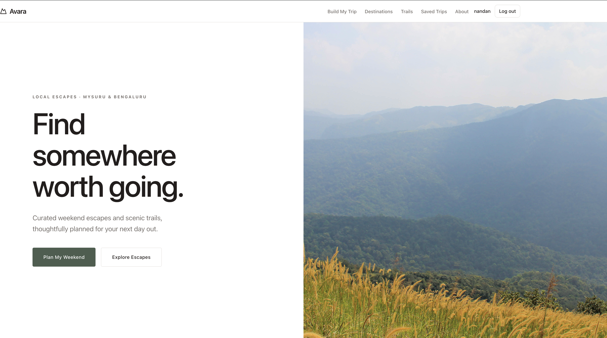

<div align="center">

# AVARA

### Find somewhere worth going.

A curated weekend travel planner for discovering scenic escapes, trekking trails, and hidden gems around Mysuru and Bengaluru.

**[🌐 Explore the Live Website](https://avara-nu-two.vercel.app/)**

[](https://avara-nu-two.vercel.app/)
[](https://nextjs.org/)
[](https://www.typescriptlang.org/)
[](https://vercel.com/)

</div>

---

## 🌄 About AVARA

AVARA is a travel discovery and weekend itinerary planning platform designed for people looking to escape their everyday routines and explore places around **Mysuru and Bengaluru, Karnataka**.

From mist-covered hills and peaceful nature escapes to sunrise viewpoints and challenging trekking trails, AVARA helps travellers discover places that match their interests and plan their next adventure.

The goal is simple: **make planning a memorable weekend trip easier, more organized, and more inspiring.**

## 📸 Website Preview



[Visit the Live Website](https://avara-nu-two.vercel.app/)

## ✨ Features

- **Explore Destinations** — Discover curated destinations, scenic escapes, and places worth visiting.
- **Destination Details** — Explore destination-specific information, highlights, travel suggestions, and itinerary details.
- **Weekend Trails** — Discover trekking experiences ranging from sunrise hikes to challenging mountain trails.
- **Trail Details** — Explore individual trails and their available information before planning a trek.
- **Trip Planner** — Plan a weekend getaway using the trip-planning experience.
- **Saved Trips** — Save destinations and trekking trails to revisit later.
- **User Authentication** — Sign in or create an account to access personalized features.
- **Explore by Mood** — Discover experiences based on the kind of weekend you're looking for.
- **Curated Recommendations** — Explore handpicked destinations and recommendations.
- **Responsive Experience** — Browse the platform across supported desktop and mobile screen sizes.

## 🗺️ Explore AVARA

| Section | Description |
|---|---|
| Home | Discover featured escapes, weekend trails, and recommendations. |
| Destinations | Browse curated travel destinations. |
| Destination Details | Explore individual destinations and their itineraries. |
| Trails | Discover scenic treks and hiking experiences. |
| Trail Details | View information about individual trekking trails. |
| Trip Planner | Start planning your next weekend getaway. |
| Saved Trips | Keep track of saved destinations and trails. |
| Authentication | Sign in or create an account to access personalized features. |

## 🛠️ Tech Stack

| Technology | Purpose |
|---|---|
| Next.js App Router | Application framework and routing |
| React | User interface |
| TypeScript | Type-safe development |
| Tailwind CSS | Styling and responsive layouts |
| shadcn/ui | Reusable interface components |
| Lucide React | Icons |
| MongoDB Atlas | Database |
| Mongoose | MongoDB object modeling |
| Auth.js | Authentication |
| Vercel | Deployment and hosting |

## 🚀 Live Demo

**Visit AVARA:** https://avara-nu-two.vercel.app/

Explore destinations, discover trekking trails, and experience the current version of the platform.

## 💻 Getting Started

Follow these steps to run AVARA locally.

### Prerequisites

Make sure you have the following installed or available:

- Node.js compatible with the project's Next.js version
- npm
- A MongoDB Atlas account and database connection string

### 1. Clone the repository

```bash
git clone https://github.com/nandan56425/AVARA.git
```

### 2. Enter the project directory

```bash
cd AVARA
```

### 3. Install dependencies

```bash
npm install
```

### 4. Configure environment variables

Create your local environment file by copying the example:

```bash
cp .env.example .env.local
```

Open `.env.local` and configure the variables:

```env
MONGODB_URI=your_mongodb_connection_string
NEXT_PUBLIC_APP_URL=http://localhost:3000
```

Replace the MongoDB placeholder with your own valid connection string. Never commit real credentials or secret values to GitHub.

For local development, keep the application URL set to `http://localhost:3000`. Use the deployed website URL in the production environment.

### 5. Start the development server

```bash
npm run dev
```

Open **http://localhost:3000** in your browser.

### 6. Create a production build

```bash
npm run build
```

To run the production build locally:

```bash
npm run start
```

## 📁 Project Structure

The project follows the Next.js App Router structure.

```text
AVARA/
├── public/
│   └── images/
│       ├── destinations/
│       ├── trails/
│       └── hero/
├── src/
│   ├── app/
│   │   ├── api/
│   │   ├── destinations/
│   │   ├── trails/
│   │   ├── plan/
│   │   └── saved-trips/
│   ├── components/
│   └── data/
├── .env.example
├── package.json
├── README.md
└── IMAGE_ATTRIBUTION.md
```

*Note: This is a high-level overview of the main project areas, not an exhaustive listing of every file.*

## 🔐 Environment Variables

AVARA uses environment variables for application configuration.

| Variable | Purpose |
|---|---|
| `MONGODB_URI` | MongoDB Atlas connection string |
| `NEXT_PUBLIC_APP_URL` | Base URL used by the application |

Configure the appropriate values in your local `.env.local` file and your deployment environment.

**Security reminder:** Never publish database credentials, authentication secrets, private API keys, or other sensitive environment values.

## 🌱 Project Vision

AVARA aims to make discovering nearby adventures easier by bringing destination discovery, trekking exploration, curated recommendations, and itinerary planning together in one place.

The initial focus is on weekend escapes around Mysuru and Bengaluru, with room to expand to more destinations and travel experiences in the future.

## 🔮 Future Possibilities

Potential areas for future development include:

- More curated destinations and trekking routes.
- Improved search, filters, and destination discovery.
- More personalized itinerary recommendations.
- Enhanced trip-planning options.
- Additional regional travel guides and experiences.

## 👨‍💻 Developer

**Nandan Yeri**

Built with curiosity, a love for technology, and an interest in making local travel easier to explore.

- **GitHub:** [@nandan56425](https://github.com/nandan56425)
- **Project
